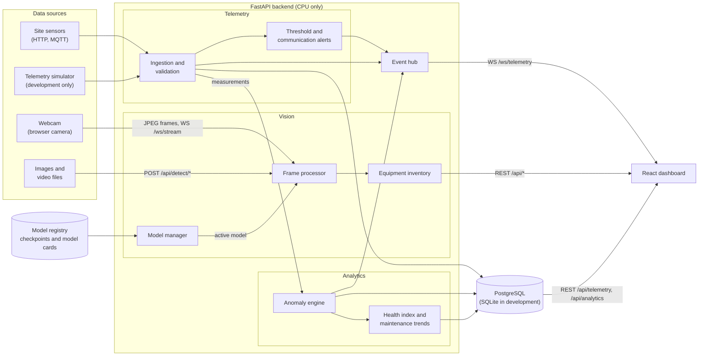
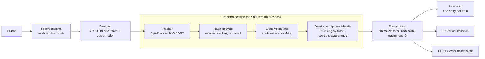
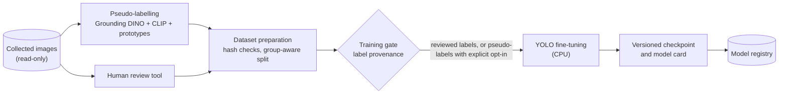

# Dynamic Digital Twin: BTS Vision and Telemetry Console

A CPU-only monitoring platform for telecom base-station (BTS) sites. It combines three layers in one web dashboard:

- **Computer vision.** Detects, tracks and inventories site equipment in images, video files and a live webcam
  stream (YOLO11n, ByteTrack / BoT-SORT).
- **Telemetry.** Collects operational sensor data over HTTP, MQTT or a built-in simulator, with live updates,
  history and threshold alerts.
- **Analytics.** Detects anomalies, computes an explainable equipment health index, and flags degradation trends
  for inspection.

No GPU, CUDA or NVIDIA driver is required. PyTorch is installed from the CPU wheel index, and the backend never
selects CUDA, even when a GPU is present (`backend/app/core/device.py`).

## Contents

- [Project status](#project-status)
- [Architecture](#architecture)
- [Repository layout](#repository-layout)
- [Installation](#installation)
- [Running the application](#running-the-application)
- [Dashboard](#dashboard)
- [API reference](#api-reference)
- [Configuration](#configuration)
- [Performance](#performance)
- [Testing](#testing)
- [Custom component model](#custom-component-model)
- [Contributing annotation reviews](#contributing-annotation-reviews)
- [Known limitations](#known-limitations)
- [Documentation](#documentation)
- [License](#license)

## Project status

| Area | Capability | Status |
|---|---|---|
| Vision | Image, video and webcam ingestion (OpenCV, browser camera) | Complete |
| Vision | Object detection with the pretrained YOLO11n model on CPU | Complete |
| Vision | Multi-object tracking (tuned ByteTrack, optional BoT-SORT with camera-motion compensation), track lifecycle, class voting | Complete; see [vision-tracking.md](docs/vision-tracking.md) |
| Vision | Session-level equipment identity with re-linking; inventory with one entry per item | Complete; verified on synthetic sequences only. IDs are not permanent |
| Vision | Custom seven-class component model | Trained on automatic pseudo-labels (`digital_twin_v2`); not yet validated against human-reviewed labels |
| Vision | Model versioning with model cards and runtime model switching | Complete |
| Vision | Browser-based annotation review tool (human sign-off, audit log, reviewed-only export) | Complete |
| Telemetry | Sensor registry, ingestion (HTTP, MQTT), PostgreSQL storage, live dashboard, threshold alerts | Complete; see [sensor-integration.md](docs/sensor-integration.md). No physical sensors connected yet |
| Telemetry | Site simulator (battery, PSU, cabinet, router, radio units, site environment) | Complete; all simulated data is labelled as such |
| Analytics | Anomaly detection, explainable health index, trend-based maintenance recommendations | Complete; see [anomaly-detection.md](docs/anomaly-detection.md). Validated on simulated scenarios only |
| 3D | 3D site model | Planned for a later milestone |

## Architecture

### System overview



### Vision pipeline (per frame)

Every stream and every video job owns its own tracking session, so concurrent sessions never share state. The
detection model is loaded once and shared, with access serialised by a lock.



### Model training workflow (offline)



**Key design decisions:**
- **Shared model.** The detection model loads once at startup. Inference runs in worker threads, never on the
  event loop.
- **Per-session tracking.** Each stream and video job has its own tracker, lifecycle and identity state.
- **Coordinates.** All box coordinates are original-frame pixels. The dashboard maps them to the displayed media.
- **Live analytics.** The anomaly engine consumes measurements as they are ingested and publishes anomalies and
  health changes through the event hub.
- **Provenance.** Each dataset and each model records whether its labels were human-reviewed or automatic. The
  dashboard shows this in the model card.

Further detail is in [docs/architecture.md](docs/architecture.md).

## Repository layout

```
dynamic_digital_twin/
├── backend/                      FastAPI service (Python 3.12)
│   ├── app/
│   │   ├── core/                 configuration, CPU device policy, logging
│   │   ├── camera/               image / video / webcam ingestion, frame-source interface
│   │   ├── vision/               detector, tracker, track lifecycle, processor, benchmark
│   │   ├── identification/       component classification, session-level equipment identity
│   │   ├── services/             detection service, model manager, statistics, inventory, video jobs
│   │   ├── api/                  REST routes and WebSocket endpoints
│   │   ├── schemas/              Pydantic models (the JSON contract)
│   │   ├── telemetry/            sensor registry, ingestion, storage (SQLAlchemy, Alembic), alerts, MQTT, simulator
│   │   ├── analytics/            features, detectors, anomaly engine, health, maintenance, validation
│   │   └── training/             taxonomy, dataset audit, annotation tooling, pseudo-labelling, train, evaluate
│   ├── configs/                  tracker, pseudo-label, telemetry and analytics configuration
│   ├── models/                   pretrained/ and custom/ checkpoints (weights are not versioned), model cards
│   ├── tests/                    pytest suite
│   └── requirements.txt
├── frontend/                     React 19, TypeScript, Vite, Tailwind CSS 4, Recharts
├── annotation/                   annotation kit, review state, pseudo-label runs
├── digital twin project datasets/   collected images (read-only)
├── docs/                         design, training, telemetry and analytics documentation
└── experiments/                  experiment code; generated runs are not versioned
```

## Installation

**Prerequisites:**
- Python 3.12
- Node.js 22
- about 3 GB of free disk space

The commands below are for Windows PowerShell.

### Backend

```powershell
cd backend
py -3.12 -m venv .venv
.venv\Scripts\python.exe -m pip install --upgrade pip

# Install the CPU build of PyTorch first so that no CUDA build is pulled in
.venv\Scripts\python.exe -m pip install torch torchvision --index-url https://download.pytorch.org/whl/cpu
.venv\Scripts\python.exe -m pip install -r requirements.txt

copy .env.example .env
```

**Verify the CPU-only installation:**

```powershell
.venv\Scripts\python.exe -c "import torch; print(torch.__version__, torch.cuda.is_available())"
# expected: 2.x.x+cpu False
```

**Model weights are not stored in the repository.**
- **Pretrained model:** download it once and place it in `backend/models/pretrained/`:

  ```powershell
  .venv\Scripts\python.exe -c "from ultralytics import YOLO; YOLO('yolo11n.pt')"
  move yolo11n.pt models\pretrained\
  ```

- **Custom models:** reproduce them with the training guide. Their model cards are versioned in
  `backend/models/custom/`.

### Frontend

```powershell
cd frontend
npm.cmd install
```

(`npm.cmd` avoids the PowerShell execution-policy restriction on `npm.ps1`.)

## Running the application

Start the backend and the frontend in two terminals:

```powershell
# Terminal 1: API on http://127.0.0.1:8000 (interactive documentation at /docs)
cd backend
.venv\Scripts\python.exe -m uvicorn app.main:app --host 127.0.0.1 --port 8000

# Terminal 2: dashboard on http://localhost:5173
cd frontend
npm.cmd run dev
```

The Vite development server proxies `/api` and `/ws` to the backend, so no CORS configuration is needed. To use a
different backend, set `BACKEND_URL` for the development proxy or `VITE_API_BASE` for a production build.

## Dashboard

| Page | Purpose |
|---|---|
| Overview | System health (backend, detection engine, sources, model), key metrics, latency chart, component distribution, equipment tracking summary, equipment health and site telemetry |
| Live Monitoring | Image upload, video processing with a synchronised overlay, and live webcam detection. Confirmed tracks are drawn solid; tentative or lost tracks are dashed |
| Object Inventory | One entry per equipment item identified in a session, with class consistency, duration, observations and lifecycle state; per-class totals and session history |
| Model Management | Model versions with label source and model card, runtime model switching, runtime performance and class list |
| Dataset Management | Read-only scan of the collected dataset |
| Equipment Monitoring | Registered equipment with sensors, live readings, connection status and active conditions |
| Sensor Management | Sensor registration and association, status, and simulator control |
| Telemetry Analytics | Historical charts (15 minutes to 7 days) and sensor availability |
| Alerts | Active conditions with acknowledgement, alert history and threshold rules |
| Equipment Health | Explainable 0–100 health index with penalty breakdown, coverage and data quality |
| Anomaly Monitoring | Live anomaly feed with evidence; acknowledge and resolve |
| Predictive Maintenance | Degradation trends and recurring anomalies with evidence levels |
| Equipment Details | Identity, visual observations, sensors, history, anomalies, health and recommendations for one item |
| Settings | Client defaults and the backend's effective runtime configuration |

**What the dashboard shows:**
- **Measured values only.** Every value comes from real inference or ingested telemetry. Missing data is shown
  as a dash, never estimated.
- **Simulated data is marked.** Every simulated value carries a SIMULATED label.
- **Identifiers are scoped.**
  - Tracker IDs are temporary.
  - Equipment IDs such as `RU-003@<session>` are stable within one stream or video, but not across sessions.
  - A permanent component registry is planned for a later milestone.

## API reference

Vision and model management:

| Method | Path | Purpose |
|---|---|---|
| GET | `/api/health` | Service status, model state, device |
| GET | `/api/model/info` | Active model, classes, thresholds, load status |
| GET | `/api/model/versions` | Checkpoints with version, label source and model card |
| POST | `/api/model/select` | Switch the detection model at runtime |
| GET | `/api/model/performance` | Runtime latency of the active model and its offline metrics |
| GET | `/api/models` | Checkpoint files in `backend/models/` |
| GET | `/api/config` | Effective runtime configuration |
| POST | `/api/detect/image` | Detect objects in an uploaded image |
| POST | `/api/detect/video` | Start a background video detection and tracking job (returns 202) |
| GET | `/api/detect/video/{id}`, `/results`, `/annotated`, `/frames/{n}` | Job status, per-frame results, annotated MP4, annotated frame |
| POST | `/api/detect/video/{id}/cancel` | Cancel a video job |
| GET | `/api/detection/stats` | Aggregate detection statistics |
| GET, DELETE | `/api/objects`, `/api/objects/{id}` | Equipment inventory (filters: `status`, `class`, `session`) |
| GET | `/api/inventory/summary` | Unique equipment items per class |
| GET | `/api/sessions`, `/api/sessions/{id}/tracks` | Sessions and the items observed in each |
| GET | `/api/dataset/summary` | Dataset validation report |
| WS | `/ws/stream` | Binary JPEG frames in, JSON frame results out |

Telemetry and analytics:
- **Telemetry:** the `/api/telemetry/*` and `/ws/telemetry` endpoints are documented in
  [sensor-integration.md](docs/sensor-integration.md#api).
- **Analytics:** the `/api/analytics/*` endpoints are documented in
  [anomaly-detection.md](docs/anomaly-detection.md#data-model-and-api).

Example frame result, shared by REST and WebSocket (box coordinates in original-frame pixels):

```json
{
  "frame_id": 30, "timestamp": "2026-11-01T00:37:41.2", "device": "cpu",
  "fps": 16.8, "inference_ms": 59.4, "frame_width": 640, "frame_height": 480,
  "detections": [
    { "track_id": 1, "class_id": 6, "class_name": "radio_unit", "confidence": 0.91,
      "bbox": { "x1": 112, "y1": 40, "x2": 388, "y2": 455 }, "component_type": "radio_unit",
      "track_state": "active", "stable_class": "radio_unit", "class_consistency": 1.0,
      "equipment_id": "RU-001@a1b2c3d4" }
  ]
}
```

WebSocket control messages: `{"type": "config", "confidence": 0.4, "iou": 0.45, "image_size": 416, "track": true}`
and `{"type": "reset"}`.

## Configuration

All settings are read from environment variables or `backend/.env` (see `backend/.env.example`). Secrets such as
database URLs, API keys and MQTT credentials are only read from the environment and are never returned by the API.

| Variable | Default | Description |
|---|---|---|
| `DEVICE` | `cpu` | Only `cpu` is supported |
| `DETECTION_MODEL` | `pretrained` | `pretrained` (COCO YOLO11n) or `custom` |
| `PRETRAINED_MODEL_PATH`, `CUSTOM_MODEL_PATH` | `models/pretrained/yolo11n.pt`, `models/custom/digital_twin_best.pt` | Checkpoint for each selection |
| `MODEL_PATH` | unset | Explicit checkpoint override, e.g. `models/custom/digital_twin_v2.pt` |
| `MODEL_FALLBACK_TO_PRETRAINED` | `false` | Load the pretrained model if the custom model cannot be loaded |
| `CONFIDENCE_THRESHOLD`, `IOU_THRESHOLD` | `0.35`, `0.45` | Default thresholds; per-request overrides are supported |
| `IMAGE_SIZE` | `416` | Inference resolution (320 is faster, 640 more accurate) |
| `FRAME_SKIP` | `1` | Process every Nth video frame |
| `TRACKER_CONFIG` | `configs/trackers/bts_bytetrack.yaml` | Tracker configuration; `bts_botsort.yaml` adds camera-motion compensation |
| `TRACK_MIN_HITS` | `3` | Frames before a track is confirmed |
| `TORCH_THREADS` | `0` | CPU threads for PyTorch (0 = PyTorch default) |
| `MAX_VIDEO_MB`, `MAX_VIDEO_FRAMES` | `200`, `5000` | Upload and processing limits |
| `TELEMETRY_DATABASE_URL` | unset | PostgreSQL connection; if unset, a local SQLite development database is used |
| `TELEMETRY_INGEST_API_KEY` | unset | Required for HTTP telemetry ingestion; if unset, HTTP ingestion is disabled |
| `MQTT_ENABLED`, `MQTT_HOST`, ... | disabled | MQTT adapter; see [sensor-integration.md](docs/sensor-integration.md#configuration) |
| `SIMULATOR_AUTOSTART`, `APP_ENV` | `false`, `development` | The simulator never starts automatically and is disabled in production |

## Performance

Measured on the development machine (Intel Core i7-1255U, 16 GB RAM, CPU only), using 30 dataset images with
`python -m app.vision.benchmark`:

| Model | 320 px | 416 px | 640 px |
|---|---|---|---|
| YOLO11n (COCO, pretrained) | 46.5 ms (21.5 FPS) | 57.4 ms (17.4 FPS) | 97.9 ms (10.2 FPS) |
| `digital_twin_v2` (custom) | 44.3 ms (22.6 FPS) | 55.5 ms (18.0 FPS) | 98.8 ms (10.1 FPS) |

**Other measurements:**
- Tracking, lifecycle and identity add 0.3–1.5 ms per frame.
- Process memory with a loaded model is about 0.7 GB.
- A live webcam stream at 640 px reaches about 14 FPS end to end.
- Anomaly analytics add less than 0.1% of one CPU core at live telemetry rates
  ([anomaly-validation.md](docs/anomaly-validation.md#cpu-performance)).

**How the backend stays responsive on CPU:**
- Inference runs in worker threads, never on the event loop.
- A warm-up pass at startup absorbs the slow first inference.
- Webcam streaming uses back-pressure: a new frame is sent only after the previous result arrives.

**If throughput is too low:** reduce `IMAGE_SIZE` to 320 or increase `FRAME_SKIP`.

## Testing

```powershell
cd backend
.venv\Scripts\python.exe -m pytest
```

The suite contains 227 tests:

| Area | Tests | Scope |
|---|---|---|
| Vision and training | 113 | Device policy, preprocessing, detection parsing, tracking, inventory, dataset audit and validation, splitting, training gate, annotation review workflow, custom-model loading, and integration tests against the real YOLO11n model on CPU |
| Tracking, identity, models | 17 | Track lifecycle, session isolation, re-linking, inventory de-duplication, model versioning and switching, pseudo-label training path (`test_vision_lifecycle.py`) |
| Pseudo-labelling | 24 | Fusion, filtering, outputs and provenance (`test_pseudo_label.py`) |
| Telemetry | 33 | Ingestion, storage, alerts, MQTT adapter, simulator, API (`test_telemetry.py`) |
| Analytics | 40 | Features, detectors, episodes, context rules, health, maintenance, API (`test_analytics.py`) |

Training and custom-model tests use synthetic fixtures in temporary directories. The application itself never
fabricates detections, measurements or metrics.

**Frontend checks:**

```powershell
cd frontend
npm.cmd run build
npm.cmd run lint
```

`build` runs the TypeScript compiler before the production build; `lint` runs oxlint.

## Custom component model

The model recognises seven classes:

| ID | Class | ID | Class |
|---|---|---|---|
| 0 | antenna | 4 | power_supply_unit |
| 1 | router | 5 | equipment_cabinet |
| 2 | cable | 6 | radio_unit |
| 3 | battery | | |

The class mapping is defined in `backend/app/training/taxonomy.py`.

**How the current model was trained.** No human-reviewed bounding boxes exist yet, so `digital_twin_v2` was
trained on automatic pseudo-labels:
- The pseudo-labels combine Grounding DINO, CLIP and visual prototypes.
- 441 of the 543 images were usable.
- Training took 28.6 minutes on CPU.

On the held-out test split, the model reaches mAP50 0.45 measured against the pseudo-labels:
- strongest on router, equipment cabinet and radio unit;
- weak on battery, power supply unit and cable.

This figure measures agreement with automatic labels and **is not an accuracy figure**. Real accuracy remains
unknown until a human-reviewed test set exists. Details are in
[custom-model-training.md](docs/custom-model-training.md#8-training-on-automatic-pseudo-labels-2026-11-08).

**Safeguards on label provenance:**
- **Reviewed labels only by default.** The training gate accepts datasets built from human-reviewed exports.
- **Pseudo-label datasets need an explicit opt-in** (`--allow-pseudo`) and an intact label manifest.
- **Each model carries a model card** recording its label source, metrics and limitations.

To use a custom model:
- **At runtime:** select it in Model Management.
- **At startup:** set `MODEL_PATH=models/custom/digital_twin_v2.pt` in `backend/.env`.

## Contributing annotation reviews

Reviewing machine-generated candidate boxes is the most valuable contribution to the project. It is the only way to
measure the model's real accuracy and to improve the weak classes. No machine-learning experience is required.

### Setup

Complete the backend installation above. Then recreate the review batches, which are copies of dataset images
and are not versioned:

```powershell
cd backend
.venv\Scripts\python.exe -m app.training.annotation_batch --name batch_01 --restage
.venv\Scripts\python.exe -m app.training.annotation_batch --name batch_02 --restage
```

### Batches

Only one person should work on a batch at a time. A batch's review state is a single file
(`annotation/reviewed/<batch>/review_state.json`), so concurrent edits conflict in Git.

| Batch | Images | Starting point |
|---|---|---|
| `batch_01` | 175 (25 per class) | Machine candidate boxes to verify and correct |
| `batch_02` | 168 | No boxes; draw them |

### Review session

```powershell
git pull
cd backend
.venv\Scripts\python.exe -m app.training.review_tool serve --review ..\annotation\reviewed\batch_01
```

Open http://127.0.0.1:8765, enter your name as reviewer, and review images. Changes are saved immediately. When
finished, stop the server and commit the review state:

```powershell
cd ..
git add annotation/reviewed
git commit -m "Review batch_01: <number> images"
git push
```

### Review guidelines

1. **Dashed boxes are machine candidates.**
   - If a box is correct, accept it (`A`).
   - If its class is wrong, choose the correct class (`1`–`7`).
   - If it fits loosely, adjust its corners.
   - If no such object is there, delete it (`Del`).
2. **Add every missed component.** Select the class under *New box class* and drag a box on the image.
3. **Label every visible component**, not only the one the folder is named after. An open cabinet usually also
   contains batteries, power supply units and cables.
4. **Cables:** draw one box around a bundle that cannot be separated, and separate boxes for clearly distinct
   cables.
5. **When uncertain,** mark the box as uncertain (`U`), select *Needs second review* and add a note.
6. **When the image is complete,** select *Mark REVIEWED* and confirm the checklist. An image with no relevant
   components can be marked reviewed without boxes.

| Key | Class | Appearance |
|---|---|---|
| 1 | antenna | Panel or mast antennas, usually white or grey, flat and tall |
| 2 | router | Transmission or router chassis with ports and line cards |
| 3 | cable | Feeder, jumper, power and fibre cables |
| 4 | battery | Battery blocks or modules |
| 5 | power_supply_unit | Rectifier or PSU shelves and modules |
| 6 | equipment_cabinet | The complete indoor or outdoor cabinet enclosure |
| 7 | radio_unit | RRUs and radio units: finned metal enclosures with connectors at the bottom |

The full rules are in [annotation-guide.md](docs/annotation-guide.md#annotation-rules). A review typically takes
1.5–3 minutes per image.

To check progress:

```powershell
.venv\Scripts\python.exe -m app.training.review_tool status --review ..\annotation\reviewed\batch_01
```

## Known limitations

- **Unknown model accuracy.** The custom model was trained and evaluated on automatic pseudo-labels; its real
  accuracy is unknown, and it is weak on battery, power supply unit and cable.
- **Tracking needs real footage.** Tracking and re-linking have been verified only on synthetic and panned-photo
  sequences, because no BTS site video is available yet.
- **Equipment identity is session-level only.** A permanent cross-session registry and RTSP site cameras exist
  only as interfaces.
- **No physical sensors connected.** Telemetry has been exercised with the simulator only.
- **Analytics validated on simulated data only.** Anomaly detection and health scoring were tuned and validated on
  simulated scenarios. No failure prediction is claimed without historical failure data.
- **SQLite fallback.** Without `TELEMETRY_DATABASE_URL`, telemetry is stored in a local SQLite development
  database rather than PostgreSQL.

## Documentation

| Document | Topic |
|---|---|
| [architecture.md](docs/architecture.md) | System architecture and design decisions |
| [vision-tracking.md](docs/vision-tracking.md) | Tracking, lifecycle, equipment identity, inventory, model management |
| [custom-model-training.md](docs/custom-model-training.md) | Dataset preparation, training, evaluation and results |
| [automated-annotation.md](docs/automated-annotation.md) | Automatic pseudo-labelling pipeline |
| [annotation-guide.md](docs/annotation-guide.md) | Annotation rules and review workflow |
| [dataset-audit.md](docs/dataset-audit.md) | Audit of the 543 collected images |
| [sensor-integration.md](docs/sensor-integration.md) | Telemetry ingestion, storage, alerts and simulator |
| [anomaly-detection.md](docs/anomaly-detection.md) | Anomaly detection, health scoring and maintenance |
| [anomaly-validation.md](docs/anomaly-validation.md) | Simulation validation and CPU performance of the analytics |
| [bts-field-testing.md](docs/bts-field-testing.md) | Plan for testing on real BTS sites |
| [phase2-progress-report.md](docs/phase2-progress-report.md) | Milestone progress report |

### Future GPU support

The architecture does not depend on the CPU. To enable a GPU later:
1. Install a CUDA build of PyTorch in a separate environment.
2. Add `"cuda"` to `SUPPORTED_DEVICES` in `backend/app/core/device.py`.
3. Set `DEVICE=cuda`.

## License

Released under the MIT License. See [LICENSE](LICENSE).
